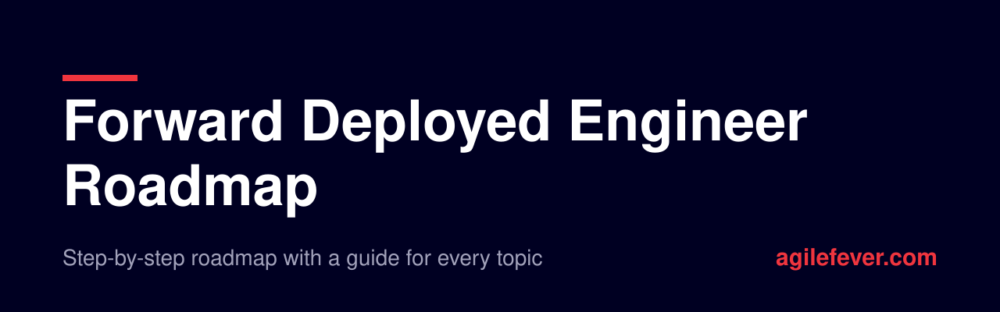

# Forward Deployed Engineer Roadmap

> A step-by-step roadmap to become an AI Forward Deployed Engineer: discover the customer problem, build the system, deploy it, and prove the result

## Table of Contents

- [Who is a Forward Deployed Engineer?](#who-is-a-forward-deployed-engineer)
- [What makes this roadmap different](#what-makes-this-roadmap-different)
- [The FDE Engagement Lifecycle](#the-fde-engagement-lifecycle)
- [How to Use This Roadmap](#how-to-use-this-roadmap)
- [Step 0: Must Know](#step-0-must-know)
- [Step 1: Discovery, Scoping, and Estimation](#step-1-discovery-scoping-and-estimation)
- [Step 2: Core Skills: Python, SQL, and the AI Toolbox](#step-2-core-skills-python-sql-and-the-ai-toolbox)
- [Step 3: LLMs, Prompts, and Context](#step-3-llms-prompts-and-context)
- [Step 4: RAG on Customer Data](#step-4-rag-on-customer-data)
- [Step 5: Agents, Tools, and Multi-Agent Systems](#step-5-agents-tools-and-multi-agent-systems)
- [Step 6: Enterprise Architecture and Integrations](#step-6-enterprise-architecture-and-integrations)
- [Step 7: Production-Grade Systems: Reliability and Scale](#step-7-production-grade-systems-reliability-and-scale)
- [Step 8: Deploying on the Cloud](#step-8-deploying-on-the-cloud)
- [Step 9: Working with ML in Enterprise AI Delivery](#step-9-working-with-ml-in-enterprise-ai-delivery)
- [Step 10: Measuring Outcomes: Evals, A/B Tests, and KPIs](#step-10-measuring-outcomes-evals-ab-tests-and-kpis)
- [Step 11: Security, Governance, and Adoption](#step-11-security-governance-and-adoption)
- [Step 12: Delivery Leadership and Stakeholder Communication](#step-12-delivery-leadership-and-stakeholder-communication)
- [Step 13: Real Deployments and Capstones](#step-13-real-deployments-and-capstones)
- [Step 14: Prepare for FDE Interviews and Certification](#step-14-prepare-for-fde-interviews-and-certification)
- [Learn This Roadmap with a Mentor](#learn-this-roadmap-with-a-mentor)
- [License](#license)

### Prepared and maintained by [AgileFever](https://agilefever.com)

### Follow AgileFever

- [LinkedIn](https://www.linkedin.com/company/agilefever/)
- [YouTube](https://www.youtube.com/@AgileFever)
- [X/Twitter](https://x.com/agilefever)
- [Website](https://agilefever.com)

## Learn with AgileFever

- [AI Forward Deployed Engineer (FDE) Bootcamp](https://agilefever.com/bootcamps/ai-forward-deployed-engineer-bootcamp/)
- [AI Forward Deployed Engineer certification](https://agilefever.com/generative-ai/ai-forward-deployed-engineer-certification/)

---

> **Note: We keep updating this roadmap with new topics and blogs.**

---

### Who is a Forward Deployed Engineer?

A Forward Deployed Engineer (FDE) is a software engineer who works directly with a customer to take an AI system from pilot to production, inside the customer's own data, tools, and workflows.

An AI Engineer mostly builds the product. An FDE makes it work for one customer, and carries what they learn back to the team.

### What makes this roadmap different

This roadmap is organised around the customer engagement, not around a single technology. Most steps ask one question: what would we do on site? We start with discovery and scoping, build the system, connect it to enterprise tools, harden it, measure it, and hand it over.

### The FDE Engagement Lifecycle

| Phase | What the FDE does | Steps |
| --- | --- | --- |
| Discover | Understand the role, the problem, and the scope of a proof of concept | Step 0, Step 1 |
| Learn the toolbox | Code, LLMs, RAG, agents | Step 2 to Step 5 |
| Integrate | Fit the system into enterprise tools | Step 6 |
| Harden | Reliability, cloud deployment, ML choices | Step 7 to Step 9 |
| Prove value | Evals, KPIs, A/B tests | Step 10 |
| Govern and hand over | Security, adoption, stakeholders | Step 11 to Step 12 |
| Ship a real case | Full deployment scenarios | Step 13 |
| Get hired | Interviews and certification | Step 14 |

### How to Use This Roadmap

This roadmap can be followed in the given order by anyone who can write basic code.

- Follow the steps in order. Each step builds on the previous one.
- Inside each step, read the blogs in the given order. Each blog explains one idea in plain words.
- Topics without a link are covered in the course. Use the official documentation of the tool while you practise them.
- After every step, ask yourself: "If a customer asked me about this tomorrow, could I explain it and make a decision?" If yes, move on.
- Build something small at the end of each step. Reading alone does not make an engineer.

Let's get started.

### Step 0: Must Know

Before the tools, we must understand the job. An FDE is not a researcher and not a pure product engineer. The work sits at the customer, with the customer's data and people. Read these first so the rest of the roadmap has a clear purpose.

- [What Is a Forward Deployed Engineer (FDE)?](https://agilefever.com/what-is-forward-deployed-engineer-fde/)
- [Forward Deployed Engineer Roles and Responsibilities](https://agilefever.com/forward-deployed-engineer-roles-responsibilities/)
- [Forward Deployed Engineer vs AI Engineer](https://agilefever.com/forward-deployed-engineer-vs-ai-engineer/)
- [Forward Deployed Engineer vs Software Engineer](https://agilefever.com/forward-deployed-engineer-vs-software-engineer/)
- [Forward Deployed Engineer vs Solution Architect](https://agilefever.com/forward-deployed-engineer-vs-solution-architect/)
- [Forward Deployed Engineer vs DevOps Engineer](https://agilefever.com/forward-deployed-engineer-vs-devops-engineer/)
- [Full Stack Developer vs Forward Deployed Engineer](https://agilefever.com/full-stack-developer-vs-forward-deployed-engineer/)
- [Is FDE Right for Backend and Full-Stack Developers?](https://agilefever.com/is-fde-right-for-backend-full-stack-developers/)
- [The FDE Career Guide](https://agilefever.com/forward-deployed-engineer-fde-roles-skills-salary-roadmap-ai-interview-future/)

**Checkpoint:** Explain in two minutes how an FDE differs from an AI Engineer and a Solution Architect.

### Step 1: Discovery, Scoping, and Estimation

Every engagement starts with a conversation, not code. In this step we learn to find the real business problem, frame the return on investment, and agree what done means before anyone writes a line.

- ROI framing for AI projects
- Running an enterprise discovery call
- Finding and ranking high-value AI use cases
- Writing a requirements document
- Scoping a proof of concept that can win the deal
- Effort and timeline estimation
- Statements of work (SOWs)
- [Readiness check before you build](https://agilefever.com/ai-transformation-readiness-self-assessment/)
- [Build vs buy vs upskill](https://agilefever.com/build-vs-buy-vs-upskill-enterprise-ai/)

**Checkpoint:** Write a one-page scope for a proof of concept, with a goal, a metric, and what is out of scope.

### Step 2: Core Skills: Python, SQL, and the AI Toolbox

An FDE spends most of the day writing code. Here we build the base: Python for AI work, SQL for reading customer data, and a clear picture of what the main AI terms mean.

- [Python for AI: NumPy, Pandas, PyTorch in the right order](https://agilefever.com/python-for-ai-roadmap/)
- [Python for AI: the free starter course](https://agilefever.com/python-for-ai-free-course-who-should-take-it/)
- SQL for FDEs: joins, aggregation, and reading customer databases
- JSON, REST APIs, and data handling
- [AI Skills Every FDE Should Learn](https://agilefever.com/ai-skills-forward-deployed-engineer-should-learn/)
- [Top FDE Skills](https://agilefever.com/forward-deployed-engineer-skills-you-need/)
- [AI terms from A to Z](https://agilefever.com/artificial-intelligence-terms-ai-glossary-examples/)

**Checkpoint:** Query a sample database with SQL and call a REST API from Python.

### Step 3: LLMs, Prompts, and Context

Customers ask why the model said something wrong or forgot something. We need enough LLM knowledge to answer, and to pick a model that fits the customer's needs.

- [Large Language Models: a complete guide](https://agilefever.com/large-language-models-llm-guide/)
- [Agentic AI vs Generative AI](https://agilefever.com/agentic-ai-vs-generative-ai/)
- Prompt structure, few-shot, and chain-of-thought
- [Prompt engineering vs context engineering](https://agilefever.com/prompt-engineering-vs-context-engineering/)
- Context windows, compression, and budgeting
- [Comparing ChatGPT, Gemini, Claude, and others](https://agilefever.com/chatgpt-vs-grok-vs-gemini-vs-claude-vs-perplexity/)
- Choosing a model for a customer's constraints

**Checkpoint:** Explain to a non-technical customer why a model can be wrong and what you would do about it.

### Step 4: RAG on Customer Data

Most customer problems come down to making a model answer from the customer's own documents. This step covers retrieval, document extraction, and how to prove the answers are grounded.

- Embeddings and chunking strategies
- Vector databases: FAISS, Pinecone, Weaviate
- Hybrid search, query rewriting, and multi-document retrieval
- [RAG pipelines with LangChain and LlamaIndex](https://agilefever.com/build-production-ready-llm-langchain-framework/)
- Agentic RAG with LangGraph
- Document intelligence: OCR, PDFs, invoices, contracts
- Fine-tuning with LoRA and QLoRA vs RAG: when each fits

**Checkpoint:** Answer questions over a small set of company documents and show the source for each answer.

### Step 5: Agents, Tools, and Multi-Agent Systems

Once retrieval works, the customer wants the system to act: look up a record, raise a ticket, hand work to another agent. We learn how agents are built and when not to use one.

- [What is Agentic AI?](https://agilefever.com/what-is-agentic-ai/)
- [Agentic AI architecture: planner, memory, tools, reflection](https://agilefever.com/agentic-ai-architecture-planner-memory-tools-reflection/)
- Function calling and structured outputs
- Memory in agents: short-term, long-term, vector
- [Agent frameworks compared: LangGraph, CrewAI, AutoGen](https://agilefever.com/ai-agent-frameworks-compared/)
- [Single-agent vs multi-agent systems](https://agilefever.com/single-agent-system-vs-multi-agent-system/)
- [Agentic AI for FDEs](https://agilefever.com/gen-ai-agentic-ai-for-forward-deployed-engineers/)
- Workflow automation with n8n

**Checkpoint:** Build a small agent that calls two tools and stops when the goal is met.

### Step 6: Enterprise Architecture and Integrations

A demo notebook is not a deployment. The customer already runs Teams, SharePoint, Salesforce, Jira, and ServiceNow, and the AI has to fit into them.

- REST, webhooks, and OAuth for enterprise systems
- [Model Context Protocol (MCP)](https://agilefever.com/model-context-protocol-explained/)
- MCP vs A2A vs ACP: agent communication protocols
- Integrating with Teams, SharePoint, Salesforce, Jira, ServiceNow, and Slack
- [Architecture patterns for agentic systems](https://agilefever.com/agentic-ai-architecture-patterns-solution-architects/)
- [Building AI products on a robust architecture](https://agilefever.com/building-successful-ai-products-with-robust-architecture/)

**Checkpoint:** Connect an agent to one external system using OAuth or a webhook.

### Step 7: Production-Grade Systems: Reliability and Scale

What works for one user in a demo fails under load. This step covers the engineering habits that keep an AI system running for a whole company.

- Caching responses and embeddings
- Rate limits and back-pressure
- Idempotency for agent actions
- Failure handling, retries, and fallbacks
- Scaling AI services
- [Building fast apps with AI](https://agilefever.com/build-fast-apps-with-ai/)
- [LLMOps vs MLOps](https://agilefever.com/llmops-vs-mlops/)

**Checkpoint:** List five ways your system can fail under load and what it does in each case.

### Step 8: Deploying on the Cloud

Customers run on different clouds, so an FDE should be able to ship on any of them. We package the system, deploy it, and watch it.

- Docker for AI services
- Deploying agents on Hugging Face Spaces, AWS Lambda, and Google Cloud
- [Azure vs AWS vs Google Cloud for AI agents](https://agilefever.com/azure-vs-aws-vs-google-cloud-ai-agents/)
- [Enterprise AI agents on Azure, AWS, and Google Cloud](https://agilefever.com/enterprise-ai-agents-on-cloud-guide/)
- Monitoring, logging, and cost control in the cloud
- Where the system runs: customer cloud, private, or in-region

**Checkpoint:** Run your service in a container on one cloud platform.

### Step 9: Working with ML in Enterprise AI Delivery

Not every problem needs an LLM. Sometimes a rule or a small model is cheaper and easier to defend. We learn to choose, and to wrap a classic model as an agent tool.

- ML vs LLM vs rules: a decision framework
- [Machine learning and deep learning from foundations](https://agilefever.com/machine-learning-deep-learning-guide/)
- XGBoost for FDEs
- Confusion matrix, precision, and recall
- Setting thresholds by business cost
- SHAP explainability
- Using a pre-trained fraud model as an agent tool

**Checkpoint:** Say when you would use a rule, a classic model, or an LLM for the same task.

### Step 10: Measuring Outcomes: Evals, A/B Tests, and KPIs

The customer pays for results, so we have to show them. This step is about measuring quality before launch and business impact after it.

- [How to evaluate an LLM application](https://agilefever.com/evaluate-llm-application/)
- [Production telemetry and tracing with LangSmith](https://agilefever.com/build-production-ready-llm-langchain-framework/)
- User-feedback signals
- A/B testing prompts, models, and agent versions
- KPI frameworks with baseline and target
- Outcome readouts for stakeholders

**Checkpoint:** Show a before-and-after number for one prompt change.

### Step 11: Security, Governance, and Adoption

Security review decides whether a pilot becomes a rollout. We cover the controls the customer will ask for, and how to get people to use the system once it is live.

- [Prompt injection and guardrails](https://agilefever.com/prompt-injection-guardrails/)
- Secrets management
- Role-based access control (RBAC) and identity-scoped tools
- Audit logging
- Compliance awareness and data residency
- AI governance
- Change management and user adoption

**Checkpoint:** Walk through a security review checklist for your own system.

### Step 12: Delivery Leadership and Stakeholder Communication

The last skill is leading the engagement. We plan the work, align the customer's teams, and explain trade-offs to executives and engineers alike.

- Project plans for AI delivery
- Aligning internal teams and coordinating partner or offshore engineers
- Agile vs Waterfall execution
- [Executive demos and board-level talking points](https://agilefever.com/ai-board-talking-points-business-leaders/)
- [AI for project managers: status reports and risk logs](https://agilefever.com/ai-agents-for-project-managers/)
- Outcome reviews with stakeholders

**Checkpoint:** Draft a project plan and a stakeholder update for an AI rollout.

### Step 13: Real Deployments and Capstones

This is where every step comes together. The course capstones are framed as customer deployments, each with discovery, integration, sign-off, and rollout. Use them as practice scenarios.

- Claims processing at a general insurer
- IT service desk incident resolution on ServiceNow, Jira, and Teams
- Supply chain exception management at a retail distributor
- Loan underwriting at a digital lender
- Enterprise HR copilot with single sign-on and MCP tools
- LEA request automation at a bank
- TaxPilot: a multi-agent tax filing assistant with human approval gates
- Go-to-market intelligence and launch planning for a beverage company

**Checkpoint:** Present one deployment scenario from discovery to rollout in ten minutes.

### Step 14: Prepare for FDE Interviews and Certification

FDE interviews test three things: coding with AI tools, designing a system for a customer problem, and handling a vague business ask. Practise all three, then decide whether a certification helps your profile.

- [Top FDE interview questions and answers](https://agilefever.com/forward-deployed-engineer-interview-questions-answers/)
- [How to Become a Forward Deployed Engineer: step-by-step](https://agilefever.com/become-forward-deployed-engineer-step-by-step-roadmap/)
- [FDE career path: jobs, growth, and opportunities](https://agilefever.com/forward-deployed-engineer-career-path-jobs-growth/)
- [FDE salary guide](https://agilefever.com/forward-deployed-engineer-salary-india-usa-global/)
- [Is an FDE certification worth it?](https://agilefever.com/forward-deployed-engineer-certification-is-it-worth-it/)
- [FDE certification requirements](https://agilefever.com/forward-deployed-engineer-certification-requirements-skills-experience/)
- [How to choose an FDE certification](https://agilefever.com/how-to-choose-a-forward-deployed-engineer-certification/)
- [FDE certification vs bootcamp](https://agilefever.com/forward-deployed-engineer-certification-vs-bootcamp/)
- [Best certifications for FDEs](https://agilefever.com/forward-deployed-engineers-best-certifications-fde/)

**Checkpoint:** Do a mock discovery call and a mock system design round with a friend.

The three interview areas map to this roadmap:

- **Coding with AI tools:** Steps 2 to 9.
- **AI system design for a customer:** Steps 4 to 11 and Step 13.
- **Customer scenarios:** Steps 1, 10, and 12.

### Learn This Roadmap with a Mentor

If you want to work through this roadmap with a live instructor, the [AI Forward Deployed Engineer (FDE) Bootcamp](https://agilefever.com/bootcamps/ai-forward-deployed-engineer-bootcamp/) covers the full path, and the [AI Forward Deployed Engineer certification](https://agilefever.com/generative-ai/ai-forward-deployed-engineer-certification/) focuses on discovery, architecture, governance, and delivery. Both end with capstone projects you can show in interviews.

### License

This roadmap is licensed under CC BY 4.0. You may share and adapt it with credit to AgileFever.
